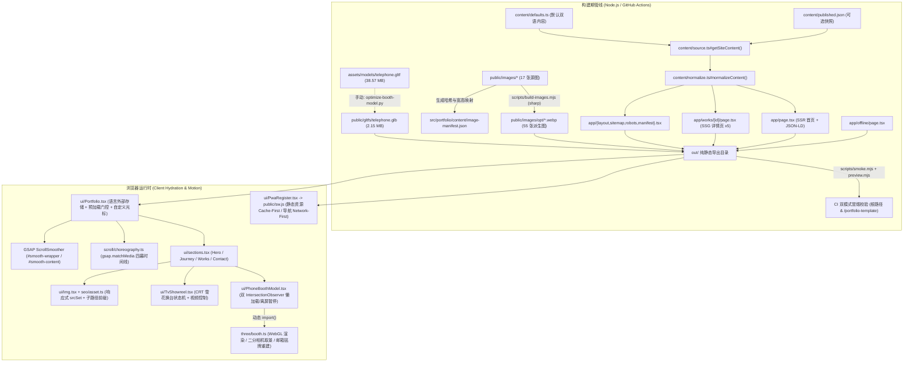
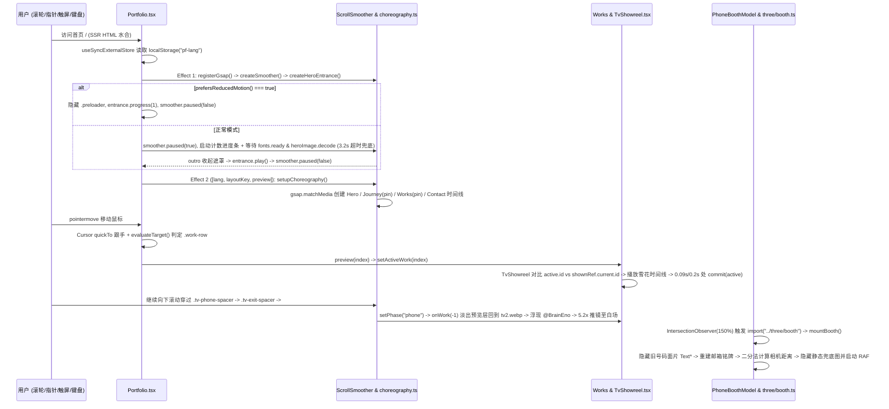
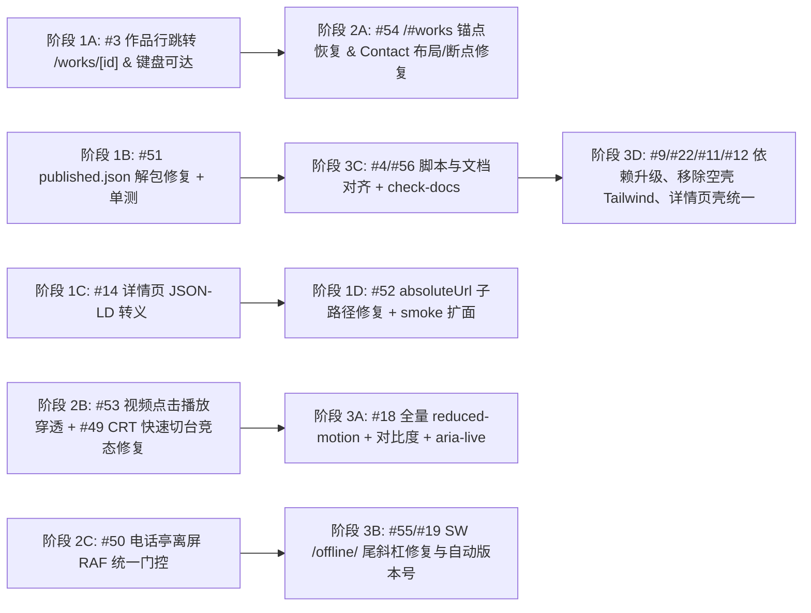

# `BrainEno/portfolio-template` 全面深度代码审查报告

## 一、项目基本信息与审查基线

| 项目 | 详情 |
| --- | --- |
| **审查仓库** | [`BrainEno/portfolio-template`](https://github.com/BrainEno/portfolio-template) |
| **审查范围** | 默认整个仓库（全部源码、构建与校验脚本、静态资源清单、GitHub Actions 工作流、文档及全部开放 Issues / 近期 PR） |
| **特别关注领域** | **UI、动画交互设计**（四幕滚动叙事、GSAP `ScrollSmoother` + `ScrollTrigger` 编排、CRT 电视 Alpha 遮罩换台与视频交互、Three.js WebGL 电话亭、响应式断点与无障碍体验） |
| **基线分支与提交** | `main` @ `6828d09426e32fea57f41b0c0375a809b35b2307`（当前工作分支 `arena/c001d26c-portfolio-template` 与 `origin/main` 完全一致，审查开始时工作区干净） |
| **最近合入 PR** | [#47](https://github.com/BrainEno/portfolio-template/pull/47)（文案润色、书名号清理、电话亭兜底图校准）、[#46](https://github.com/BrainEno/portfolio-template/pull/46)（CRT Alpha 切台与环境光重构）、[#45](https://github.com/BrainEno/portfolio-template/pull/45)（Alpha 抠图电视机）；注：[#48](https://github.com/BrainEno/portfolio-template/pull/48) 处于 `CLOSED`（未合并）状态 |
| **审查执行时间** | `2026-11-03T11:28:21+08:00`（`Asia/Hong_Kong`） |

---

## 二、项目规模与整体设计分析

### 2.1 代码库规模统计

基于 `git ls-files` 对基线 `6828d09` 全部 **135 个受控文件**进行精确统计，按职责区分生产源码、生成代码/派生资源、测试与校验脚本、构建辅助脚本、配置与文档如下：

| 分类 | 文件数（文本 / 二进制） | 文本行数 | 体积 | 说明 |
| --- | ---: | ---: | ---: | --- |
| **生产源码**（`src/**` 除生成清单 + `public/sw.js`） | 27（27 / 0） | 5,583 | 175.8 KB | 应用路由、UI 组件、GSAP 滚动编排、Three.js 渲染、内容归一化、SEO 与 PWA Worker |
| **测试与校验脚本**（`scripts/{smoke,test-tv-assets,tv-glass}.mjs`） | 3（3 / 0） | 317 | 14.2 KB | 静态产物爬虫冒烟测试、CRT 透明开口覆盖率断言、玻璃框可视化核对 |
| **构建与辅助脚本**（`scripts/{build-static,build-images,preview,optimize-booth-model,art/*}`） | 5（5 / 0） | 789 | 33.9 KB | 静态导出封装、响应式 WebP 生成、Brotli 静态预览服、glTF 压缩、占位插画生成 |
| **生成代码与派生资源**（`image-manifest.json` + `public/images/opt/*` + `telephone.glb` + `icons/*`） | 60（1 / 59） | 197 | 5,246.6 KB | `build-images.mjs` 产出的清单与 55 张 WebP、`optimize-booth-model.py` 产出的 2.15 MB GLB、3 张 PWA 图标 |
| **工程配置与 CI 工作流**（`package*.json`、`next.config.ts`、`static.yml` 等） | 10（10 / 0） | 7,165 | 242.5 KB | 其中 `package-lock.json` 占 6,838 行，其余 9 个手写配置与 CI 文件共 **327 行** |
| **文档与法务声明**（`README.md`、`docs/*.md`、`LICENSE`、`TERMS.md` 等） | 12（12 / 0） | 1,310 | 67.5 KB | 架构、快速上手、静态发布、路线图与专有版权声明（非开源许可） |
| **原始媒体与 3D 源模型**（`public/images/*` 源图 + `assets/models/telephone.gltf`） | 18（1 / 17） | 843 | 41,815.3 KB | 17 张源图（约 4.1 MB）+ 内嵌 Base64 Buffer 的源 `telephone.gltf`（**38.57 MB** / 843 行） |
| **合计** | **135（59 / 76）** | **16,204** | **46.48 MB** | 剔除 `package-lock.json` 与 `.gltf` 后的核心手写文本代码/文档共 **8,523 行** |

**生产源码（27 文件 / 5,583 行）分层明细：**

| 生产代码子层 | 目录 / 文件 | 文件数 | 行数 | 占比 |
| --- | --- | ---: | ---: | ---: |
| 样式层 | `src/portfolio/styles/{portfolio,work-detail}.css` | 2 | 2,026 | 36.3% |
| UI 组件层 | `src/portfolio/ui/{Portfolio,sections,TvShowreel,PhoneBoothModel,Img,PwaRegister,cx}.tsx` | 7 | 1,417 | 25.4% |
| GSAP 滚动编排层 | `src/portfolio/scroll/choreography.ts` | 1 | 590 | 10.6% |
| Three.js WebGL 渲染层 | `src/portfolio/three/booth.ts` | 1 | 518 | 9.3% |
| 内容契约与归一化层 | `src/portfolio/content/{types,defaults,normalize,source}.ts` | 4 | 492 | 8.8% |
| App Router 路由与元数据层 | `src/app/{layout,page,works/[id]/page,offline/page,manifest,robots,sitemap,globals.css,icon.svg}` | 9 | 335 | 6.0% |
| SEO 与子路径解析层 | `src/portfolio/seo/{site,asset}.ts` | 2 | 121 | 2.2% |
| PWA 离线缓存层 | `public/sw.js` | 1 | 84 | 1.5% |

---

### 2.2 整体设计理念与技术架构

#### 核心设计哲学
项目历经多轮演进后（尤其是 PR #29、#30、#32），从早期的“PostgreSQL + Drizzle + `/admin` 在线编辑 + SSR 动态渲染”彻底收敛为**纯静态单向构建架构（Static-First Editorial Narrative）**，围绕四条核心设计原则展开：

1. **构建即发布（Deploy-as-Publish）**：彻底移除运行时服务端、数据库、API 路由与后台会话；全站内容收敛为仓库内的单一静态数据源（优先 `src/portfolio/content/published.json`，缺省回退 `src/portfolio/content/defaults.ts`），在 `next build`（`output: "export"`）期间一次性烘焙进静态 HTML、JSON-LD 与 `sitemap.xml`。
2. **画框几何契约（Media-Frame Contract）**：所有图片均置于由 CSS 严格限定宽高比的容器内（`object-fit: cover`、`overflow: hidden`、`contain: layout paint`），使图片源分辨率与长宽比变化不会引起文档流回流或破坏 GSAP `ScrollTrigger` 的像素测量。
3. **四幕电影式滚动叙事（Four-Act Scroll Choreography）**：
   - **第一幕 `Hero`（`#intro`）**：倾斜排印标题 + 双条差速遮罩 + 主视觉图揭示；
   - **第二幕 `Journey`**：桌面端单屏 `pin` 住后横向展开“肖像回正 → 第一段简介 → 横向摄影长卷（`.rail`）→ 尾声双图与第二段哲思（`.coda`）”，停留时长通过 `dwell()` 按中英文字符密度自适应；
   - **第三幕 `Works`（`#works`）**：固定街景 CRT 电视机照片（`tv2.webp`），未选中时保持原图零贴片；悬停/聚焦作品行时启动 `TvShowreel` 三态换台动画（垂直同步坍缩 → 模拟雪花噪点 → 画面锁定），在底层绘制项目画面并由上层 Photoshop 真实透明通道图（`tv2-alpha.webp`）裁切出弧形玻璃边缘，同时投射环境光（`.tv-ambient`）；滚过列表后还原原图，浮现 `@BrainEno` 台标并放大推镜溶解至白场（`.tv-whiteout`）；
   - **第四幕 `Contact`（`#contact`）**：负外边距（`-56vh`）叠入电视白场退场区间，左侧大字标题组配合右侧按需加载的 Three.js 3D 红色电话亭（沿右下至左上弧线落位、自动慢速自转、支持鼠标惯性拖拽、动态将门板旧电话号码面片隐藏并用法线吸附的 `CanvasTexture` 铭牌替换为联系邮箱）。
4. **双部署形态同构（Root & Sub-path Agnostic）**：针对 GitHub Pages 项目站（挂载于 `/<repo>/` 子路径）与自定义根域名两种形态，通过 `seo/asset.ts#asset()` 与 `BASE_PATH` 统一处理手写资源路径、PWA `manifest` 作用域及 Service Worker 缓存前缀。

#### 系统分层与数据流架构图

---

### 2.3 接口、契约与依赖清单

本项目**不存在运行时后端 API、不存在数据库表结构**。系统边界由以下四类静态与模块契约构成：

1. **静态导出路由清单（`out/` 产物端点）**：

   | 路由路径（以子路径 `/<repo>` 为前缀） | 源码入口 | 渲染方式 | 用途与输出格式 |
   | --- | --- | --- | --- |
   | `/` | `src/app/page.tsx` | Static HTML | 四幕主叙事页 + `WebSite`/`Person`/`CreativeWork` JSON-LD |
   | `/works/[id]/`（共 5 页） | `src/app/works/[id]/page.tsx` | SSG (`generateStaticParams`) | 作品独立详情页 + `BreadcrumbList` JSON-LD |
   | `/offline/` | `src/app/offline/page.tsx` | Static HTML (`noindex`) | Service Worker 断网导航兜底页 |
   | `/sitemap.xml` | `src/app/sitemap.tsx` | Metadata Route | 包含首页与全部作品页的站点地图 |
   | `/robots.txt` | `src/app/robots.tsx` | Metadata Route | 允许全站抓取，仅屏蔽 `/offline` |
   | `/manifest.webmanifest` | `src/app/manifest.tsx` | Metadata Route | PWA 安装清单（含图标与 `#works`/`#contact` 快捷方式） |
   | `/icon.svg` | `src/app/icon.svg` | Static Asset | 矢量站点图标 |

2. **构建期环境变量契约**：
   - `NEXT_PUBLIC_SITE_URL`（回退链：`SITE_URL` → `URL` → `DEPLOY_PRIME_URL` → `CF_PAGES_URL` → `http://localhost:3000`）：决定 `canonical`、`sitemap.xml`、`robots.txt`、Open Graph 与 JSON-LD 的公开站点根地址。
   - `NEXT_PUBLIC_BASE_PATH`（默认 `""`）：决定 Next `basePath`/`assetPrefix`、`seo/asset.ts#asset()`、PWA `manifest` `scope`/`start_url` 及 Service Worker 注册路径。

3. **核心内部模块接口契约**：
   - `content/source.ts`：`getSiteContent(): Promise<PortfolioContent>`、`getContentUpdatedAt(): Promise<string | null>`。
   - `content/normalize.ts`：`normalizeContent(input: unknown): PortfolioContent`、`slugify(value: string): string`、`t(text, lang): string`。
   - `scroll/choreography.ts`：`createSmoother()`、`createHeroEntrance()`、`scrollToSection(id)`、`setupChoreography(opts): () => void`。
   - `three/booth.ts`：`mountBooth(host, options): Promise<{ setPaused(paused: boolean): void; dispose(): void }>`。

4. **第三方依赖矩阵（`package.json`）**：
   - **生产依赖（7 项）**：`next@16.2.6`、`react@19.2.6`、`react-dom@19.2.6`、`gsap@^3.15.0`（含 `ScrollTrigger`、`ScrollSmoother`）、`three@^0.181.2`（通过动态 `import()` 拆包）、`@fontsource-variable/inter@^5.3.0`、`@fontsource/inria-serif@^5.3.0`。
   - **开发依赖（10 项）**：`typescript@5.9.3`、`sharp@^0.34.5`、`eslint@9.39.4`、`eslint-config-next@16.2.6`、`postcss@8.5.8`、`tailwindcss@4.1.17`、`@tailwindcss/postcss@4.1.17`（后两项实际未被任何样式表 `@import` 使用，属空壳依赖）及 `@types/*`。

---

### 2.4 架构合理性与技术债评估

- **合理的架构决策**：
  - **严格单向、无循环依赖**：经全量 import 追踪，`app/*` → `portfolio/{ui,seo,content}`，`ui/*` → `{scroll,three,content,seo}`，`scroll/*` 与 `three/*` 互不依赖且均不反向引用 `ui/*` 或 `app/*`，不存在任何循环依赖。
  - **彻底砍掉伪需求复杂度**：删除服务端数据库与浏览器内模拟后台后，安装包从早期 679 降至 381，彻底根除了默认口令、SQL/连接池、未授权上传等一整类高危服务端风险。
  - **WebGL 与主包解耦**：`three` 仅在 `PhoneBoothModel.tsx:49` 接近视口 `150%` 时动态 `import("../three/booth")`，未阻塞首屏水合。
- **现存复杂度与技术债务**：
  1. **DOM 类名字符串隐式耦合**：`choreography.ts`（590 行）完全通过全局/作用域 CSS 选择器字符串（如 `.tv-box`、`.story-photo-mask`、`.contact-line-text`）驱动 `sections.tsx` 与 `Portfolio.tsx` 的节点，并深度耦合 `portfolio.css`（1,997 行）中的初始定位与尺寸常量，重构任一侧极易引发静默错位（如目前 Contact 断点在 CSS 改成了 `1023px`，而 `choreography.ts` 仍留在 `768px`）。
  2. **大体积源资产直接入 Git 历史**：`assets/models/telephone.gltf` 单文件 **38.57 MB**（占整仓体积的 83%）未使用 Git LFS，且 `public/images/headline.png`（1.98 MB 无损 PNG）原样随 `out/` 导出。
  3. **空壳构建链路与多处硬编码脚本**：PostCSS 挂载了完全未使用的 `@tailwindcss/postcss`；`test-tv-assets.mjs`、`tv-glass.mjs` 用正则硬编码抓取 `defaults.ts` 文本而非复用内容源模块。

---

## 三、全面代码质量多维度审查

> 以下严格区分 **真实 Bug**（代码逻辑与预期契约/规范直接冲突）、**潜在风险**（特定输入、网络或工具操作下触发故障）、**架构改进建议**与**产品功能缺口**。

### 3.1 健壮性（Robustness）

- **[真实 Bug · P1] `published.json` 外层包装未解包导致用户配置 100% 静默丢失**（新建 Issue [#51](https://github.com/BrainEno/portfolio-template/issues/51)）
  - **证据**：`README.md:55`、`docs/QUICKSTART.md:40-44`、`docs/STATIC_EXPORT.md:53-55` 均要求 `published.json` 采用 `{ "exportedAt": "...", "content": { ... } }` 包装结构，`source.ts:44` 的 `getContentUpdatedAt()` 也按该外层字段提取时间戳；但 `source.ts:36-39` 的 `getSiteContent()` 未解包 `published.content`，直接将外层对象传入 `normalizeContent(published)`（`normalize.ts:79-80`），导致顶层业务键全部匹配失败并静默回退至 `defaultContent`。已通过 `npx tsx` 实测证实。
- **[真实 Bug · P2] CRT 快速往返悬停（`A → B → A`）被未取消的旧时间线延迟回调覆盖**（已有开放 Issue [#49](https://github.com/BrainEno/portfolio-template/issues/49)）
  - **证据**：`src/portfolio/ui/TvShowreel.tsx:92-95` 在 `timeline.current?.kill()`（第 117 行）之前执行 `if (nextId === currentId && Boolean(active) === rigActiveRef.current) return;`。由于切台时间线在 `0.2s` 处才延迟执行 `commit(B)` 更新 `shownRef.current`（第 195 行），若用户在 `<200ms` 内从 A 划过 B 再回到 A，第三次 effect 因 `shownRef.current` 仍为 A 提前返回，未杀死 B 的时间线，最终电视画面停留在 B 而列表高亮在 A。
- **[真实 Bug · P2] 3D 电话亭异步加载与标签页可见性竞态导致离屏渲染循环常驻**（已有开放 Issue [#50](https://github.com/BrainEno/portfolio-template/issues/50)）
  - **证据**：`src/portfolio/ui/PhoneBoothModel.tsx:46-58,92-99` 在 `150%` 视口边距触发异步 `mountBooth()`，但 `pause` `IntersectionObserver` 仅执行 `handle?.setPaused(!visible)` 而未记录最新 `visible` 状态；若模型加载完成前用户已滚离底部，`mountBooth()` 完成后默认 `paused = false` 立即启动 `requestAnimationFrame` 循环（`booth.ts:437,488`）。同时 `booth.ts:490` 的 `visibilitychange` 直接调用 `setPaused(document.hidden)`，在离屏状态下切后台再回前台也会无条件唤醒离屏 WebGL 渲染。
- **[潜在风险] `normalizeContent` 静默截断且无构建期校验日志**
  - **证据**：`src/portfolio/content/normalize.ts:10,23,58` 将可变数组硬截断至 `MAX_LIST = 40`、字符串截断至 `6000` 字符，且对缺失图片文件或字段类型错误不做任何构建期告警打印（`ROADMAP.md:221` 亦已承认为待办项）。

### 3.2 安全性（Security）

- **攻击面收敛评估**：纯静态导出后，不存在服务端会话、口令认证、数据库连接与文件上传接口，原服务端高危面已清零。
- **[真实 Bug · P1] 作品详情页 JSON-LD 未转义 `</script>`，存在脚本标签闭合注入**（已有开放 Issue [#14](https://github.com/BrainEno/portfolio-template/issues/14)）
  - **证据**：首页 `src/app/page.tsx:14` 正确使用了 `JSON.stringify(jsonLd(content)).replace(/</g, "\\u003c")`，但 `src/app/works/[id]/page.tsx:62` 直接输出 ``，将直接截断脚本块并注入可执行 HTML/JS。
- **[潜在风险 · P1] 生产与构建依赖存在已知高危漏洞且开启 `legacy-peer-deps=true`**（已有开放 Issue [#9](https://github.com/BrainEno/portfolio-template/issues/9)）
  - **实测证据**：运行 `npm audit` 检出 **17 个漏洞（1 Critical、2 High、14 Moderate）**；`npm audit --omit=dev` 检出 **3 个漏洞**：`next@16.2.6`（Critical，涉及开发服 MCP 信息泄露及多项 App Router 公告）、`postcss@8.5.8`（High，CSS `sourceMappingURL` 路径穿越与 `</style>` 转义漏洞）、`sharp@0.34.5`（High，`libvips`/`libheif`/`librsvg` CVE-2026-33327 等，构建期处理外部图片时受影响）。此外 `.npmrc:1` 仍保留 `legacy-peer-deps=true` 掩盖依赖树版本约束。
- **[低风险细节] 外链 `rel` 属性细微不一致**：`src/app/works/[id]/page.tsx:69` 使用了完整的 `rel="noreferrer noopener"`，而 `src/portfolio/ui/sections.tsx:417,430` 仅写 `rel="noreferrer"`（现代浏览器隐含 `noopener`，建议统一）。

### 3.3 架构与可维护性（Architecture）

- **[真实 Bug / 工具链失配] 校验脚本绕过 `source.ts` 硬编码正则解析 `defaults.ts`**（合并入新建 Issue [#51](https://github.com/BrainEno/portfolio-template/issues/51)）
  - **证据**：`scripts/test-tv-assets.mjs:8-15` 与 `scripts/tv-glass.mjs:23-41` 直接读取 `defaults.ts` 源码并用正则提取 `tv` 块，完全忽略 `published.json`，破坏了 `source.ts`“唯一内容入口”的架构不变量。
- **[潜在风险 · P3] `scripts/art/generate-art.mjs` 与现行素材命名严重脱节**（新建 Issue [#56](https://github.com/BrainEno/portfolio-template/issues/56)）
  - **证据**：`generate-art.mjs:193-233` 仍按旧文件名生成 `tv.webp`、`phone-booth-cutout.png`、`figure.jpg`、`tree1..5.jpg`、`accent-1..2.jpg`、`works/no-wave.jpg` 等 9 个已删除的孤儿文件，并**无条件覆盖**正在使用的 `profilephoto.jpg` 与 4 张 `works/*.jpg` 封面图，且第 63 行存在 `<stop offset="4a3c26"/>` 非法 SVG 属性。
- **[架构改进建议] 设计令牌作用域局限于 `.pf` 且空转 Tailwind PostCSS**（已有开放 Issue [#22](https://github.com/BrainEno/portfolio-template/issues/22)）
  - **证据**：`--accent` 与 `--stage` 仅注入在首页 `.pf` 容器上（`Portfolio.tsx:340-347`、`portfolio.css:41-42`），导致 `/works/[id]`（`work-detail.css:20`）与 `/offline`（`offline/page.tsx:27`）只能硬编码 `#e55139`；`postcss.config.mjs` 加载 `@tailwindcss/postcss`，但全仓 `grep -rn "tailwind" src` 为 0。

### 3.4 UI/UX 与动画交互设计（特别关注维度）

- **[真实 Bug · P0] 作品列表无任何详情页/项目外链跳转入口，`/works/[id]` 沦为孤岛页面且键盘无法激活**（已有开放 Issue [#3](https://github.com/BrainEno/portfolio-template/issues/3)）
  - **证据**：`src/portfolio/ui/sections.tsx:222-246` 将每条作品渲染为 `<li tabIndex={0} onMouseEnter={() => onPreview(index)} onFocus={() => onPreview(index)} onClick={() => onPreview(index)}>`，无 `<Link href={`/works/${work.id}/`}>`、无 `<a href={work.url}>`、无 `onKeyDown` 处理。实测 `out/index.html` 中指向 `/works/` 的内链数量为 **0**。
- **[真实 Bug · P1] 电视作品区视频模式点击播放死锁**（新建 Issue [#53](https://github.com/BrainEno/portfolio-template/issues/53)）
  - **证据**：① `portfolio.css:996-1006` 中 `.works-list` 拥有 `position: relative; z-index: 4` 且在 `rows` 阶段保持默认 `pointer-events: auto`，整宽遮挡下方被 pin 住的 `.tv-stage`，拦截所有朝向 `.tv-video` 的点击；② 鼠标从 `.work-row` 移向电视屏幕时，`sections.tsx:206-210` 的 `<ol onMouseLeave>` 因 `relatedTarget` 是外层 `.works-list` 立即调用 `onPreview(-1)`，且 `Portfolio.tsx:130-139` 在指针经过容器留白或电视机外壳时立即调用 `onHoverWork(-1)`，将 `data-active` 置为 `"false"` 并关闭 `.tv-video { pointer-events: auto }`（`portfolio.css:738`），电视在鼠标到达前即雪花关机；③ `<video>` 无键盘可访问控制。
- **[真实 Bug · P2] `/#works` 与 `/#contact` 锚点导航失效、桌面端 3D 电话亭侵入顶栏及 CSS/GSAP 断点失步**（新建 Issue [#54](https://github.com/BrainEno/portfolio-template/issues/54)）
  - **证据**：① `works/[id]/page.tsx:63` 返回链接指向 `/#works`、`manifest.tsx:37` 快捷方式指向 `/#works` 与 `/#contact`，但 `Portfolio.tsx:251-338` 在 `ScrollSmoother` 初始化及 `setupChoreography` 插入约 `650vh` pin-spacer 后从未读取 `window.location.hash` 定位；② 桌面端 `.contact-inner`（`portfolio.css:1193`）顶部 `padding` 为 `0`、`.contact-booth`（`portfolio.css:1370-1391`）`top: 0`，导致红色 3D 电话亭顶盖直接垫在固定顶栏 `.header`（`height: 52px; mix-blend-mode: difference`，`portfolio.css:202-217`）右侧导航下方发生差值反色；③ `choreography.ts:416` 电话亭入场 `end: "top -4%"` 在 `100svh` 末屏上不可达（最多滚至 `top 0%`，总进度截断于 `96.15%`，`.contact-booth-shadow` 停在 `89.7%`）；④ Contact CSS 在 `max-width: 1023px` 或 `max-aspect-ratio: 11/10` 已切为单列纵向堆叠（`portfolio.css:1632`），但 `choreography.ts:15` 仍按 `min-width: 768px` 运行桌面轨迹，且 `sections.tsx:308-371` 字号探针未响应中英文切换导致的走马灯高度变化。
- **[真实 Bug / 无障碍缺口 · P2] `prefers-reduced-motion: reduce` 未覆盖前三幕核心滚动动效**（已有开放 Issue [#18](https://github.com/BrainEno/portfolio-template/issues/18)）
  - **证据**：`docs/ROADMAP.md:163` 声称已将 `prefers-reduced-motion`“从少动改成不动”，但实际源码 `src/portfolio/scroll/choreography.ts:562-570` 中，`reduce` 仅传给了 `contact(scope, desktop, reduce)`，**完全未传给 `heroScroll(desktop)`、`journeyDesktop(scope)`、`journeyMobile(scope)` 与 `television(scope, opts, desktop)`**！开启系统“减弱动态效果”的用户在滚动时仍会遭遇 `Journey` 约 `6.5` 屏 pin 横移以及 `Works` 退场 `exitTl`（第 381–383 行）对 `.tv-box` 高达 **`5.2×` 全屏缩放与 `-5.5°` 旋转**的前庭刺激动画。
- **[潜在风险 / UI 细节] 白底 Contact 区小字对比度不达标、作品行衬线悬停字裁切风险、滚动条隐藏与详情页体验割裂**：
  - **WCAG 2.1 AA 对比度实测不达标**：经对 `portfolio.css` 真实色值做相对亮度计算，白色 `#ffffff` 背景上的 `.contact-meta-label`（`11px`，`rgba(10,10,10,0.44)`）对比度仅 **`3.07:1`**、`.contact-colophon`（`13px`，`rgba(12,12,12,0.50)`）为 **`3.64:1`**、`.contact-kicker-index`（`#e55139`）为 **`3.77:1`**、`.contact-kicker`（`rgba(10,10,10,0.52)`）为 **`3.95:1`**，均低于正文字号 `<18pt` 所需的 **`4.5:1`** 标准（Lighthouse 首屏扫描时该区处于离屏/透明态故未检出）。
  - **作品行悬停字体宽度裁切风险**：`portfolio.css:1060-1087` 中 `.work-row-title` 宽度由静态子元素 `.work-row-name`（`Inter 400`，`3.7vw`）撑开，而激活态滑入的 `.work-row-name-alt` 为 `position: absolute; inset: 0; font-family: var(--font-serif); font-weight: 600; font-size: 3.9vw; letter-spacing: 0.02em`，外层 `.work-row-mask` 带 `overflow: hidden`。当 `3.9vw + 0.02em` 加粗衬线字总宽超过 `3.7vw` 无衬线字宽时，右侧尾字母会被直接裁切（注：`layout.tsx:13-14` 仅引入了 `Inria Serif` 400 与 700 字重，`600` 会回退合成至 `700`）。
  - **交互可感知性缺口**：`portfolio.css:23-32` 全局隐藏原生滚动条（`scrollbar-width: none`），长卷页面缺少阅读进度反馈；`Portfolio.tsx:281` 预加载期间 `smoother.paused(true)` 最长锁滚 `3.2s` 且遮罩标为 `aria-hidden="true"`；详情页 `/works/[id]` 无站点顶栏、不继承 `localStorage` 中用户所选语言（已有开放 Issue [#11](https://github.com/BrainEno/portfolio-template/issues/11)、[#12](https://github.com/BrainEno/portfolio-template/issues/12)）。

### 3.5 性能与资源管理（Performance）

- **导出体积超出文档预算 81%（实测数据）**：
  - `docs/ROADMAP.md:208` 将 `out/` 体积守门目标定为 **`6.2 MB`**，但本次对构建产物 `out/` 的实测总体积为 **`11.25 MB`（11,796,865 bytes）**。
  - 分项实测：`images/` 占 **`7,144.9 KB`（6.98 MB）**，`gltfs/telephone.glb` 占 **`2,205.1 KB`**，`_next/` 占 **`1,689.5 KB`**，`works/` HTML 占 **`244.6 KB`**。
  - 膨胀主因：`public/images/headline.png` 单张无损 PNG 原图高达 **`1.98 MB`**，且 `tv2.webp` + `tv2-alpha.webp` 原图（各 `470 KB`）与 `opt/` 下 4 张派生图（合计 `1.23 MB`）共存，仅电视素材即占 **`2.17 MB`**。
- **JS / CSS 分包实测合理，但存在两处运行时微开销**：
  - `out/_next/static/chunks/` 实测最大块 `17ea7bl35itq-.js`（raw `580.9 KB` / gzip `147.5 KB`）为动态 `import("../three/booth")` 分离出的 Three.js 独立异步包，首屏不加载；GSAP + ScrollSmoother 包 `07lhk_q6pmm3r.js` 为 raw `222.2 KB` / gzip `69.2 KB`；主样式 `0cu4fl5k27t4m.css` 为 raw `26.0 KB` / gzip `6.2 KB`。
  - **运行时开销点 1**：`choreography.ts:535-539` 在 Contact 跑马灯 `ScrollTrigger.onUpdate` 中，每次滚动帧均创建两个新的 `gsap.to(loop, ...)` 实例调节 `timeScale`（其中延迟 tween 未设 `overwrite: "auto"`，快速滚动时排队创建大量短命 tween）。
  - **运行时开销点 2**：`portfolio.css:899-930` 的 `.tv-ambient-halo` 与 `.tv-ambient-ground` 对两张 `` 同时施加 `filter: blur(2vw) saturate(1.45)` + `radial-gradient` `mask-image` + 外层 `mix-blend-mode: screen`，在缩放推进阶段低端集显/移动 GPU 合成开销较高。
- **[真实 Bug · P2] `public/sw.js` 离线兜底路径缺尾斜杠且预缓存桶错位**（新建 Issue [#55](https://github.com/BrainEno/portfolio-template/issues/55)）
  - **证据**：`next.config.ts:28` 启用 `trailingSlash: true`（导出 `out/offline/index.html`），但 `public/sw.js:20,78` 请求无尾斜杠 `at("/offline")`；在 GitHub Pages 等托管上会跟随 `301 -> /offline/` 缓存 `redirected === true` 的响应，断网导航（`redirect: "manual"`）返回该缓存响应时会被浏览器按 WHATWG Fetch 规范直接报错拦截（`ERR_FAILED`）。同时 `at("/icons/icon-192.png")` 在 `install` 写入 `PAGES` 桶，而 `fetch` 匹配 `/icons/` 只读 `STATIC` 桶，预缓存永不命中。

### 3.6 测试质量与覆盖盲区（Testing）

- **现有测试实测通过**：
  - `scripts/test-tv-assets.mjs`（36 行）：校验 `tv2.webp` 与 `tv2-alpha.webp` 宽高比一致，且 `works.tv.screen` 完整覆盖 `19,465` 个透明像素开口 `(656, 670)–(820, 791)`。
  - `scripts/smoke.mjs`（203 行）：真实拉起 `preview.mjs` 静态服，对根路径与 `/portfolio-template` 子路径构建分别遍历 8 个页面与 89 个引用资源 URL、校验 404 路由、`robots.txt`、`manifest` `scope` 及 Brotli 压缩。
- **核心测试盲区**：
  1. **零单元测试**：`normalizeContent`、`getSiteContent`、`slugify`、`asset`、`absoluteUrl` 等纯函数无任何单测（直接放过了 [#51](https://github.com/BrainEno/portfolio-template/issues/51) 与 [#52](https://github.com/BrainEno/portfolio-template/issues/52)）。
  2. **`smoke.mjs` 扫描盲区**：`smoke.mjs:169-174` 仅正则提取 `src="/..."`、`href="/..."` 与 `srcSet`，未扫描 `<meta property="og:image" content="...">`、`twitter:image`、JSON-LD 内同源 URL（放过了 [#52](https://github.com/BrainEno/portfolio-template/issues/52)），也未校验 `sw.js` 的 `CORE` 列表路径是否直返 `200`（放过了 [#55](https://github.com/BrainEno/portfolio-template/issues/55)），且 `preview.mjs:46` 自动削去尾斜杠掩盖了线上目录 `301` 行为。
  3. **零浏览器级 UI / 动效回归测试**：无 Playwright/WebGL 自动化验证，因此 `.works-list` 遮挡视频点击（[#53](https://github.com/BrainEno/portfolio-template/issues/53)）、`/#works` 锚点失效（[#54](https://github.com/BrainEno/portfolio-template/issues/54)）及 `TvShowreel` 快速切台竞态（[#49](https://github.com/BrainEno/portfolio-template/issues/49)）均无法在 CI 暴露。

### 3.7 CI/CD 与发布可靠性（CI/CD）

- **现状评估**：`.github/workflows/static.yml` 设计清晰，划分 `verify`（PR 与 `main` push 必跑：`npm ci` → `typecheck` → `lint` → `test:tv-assets` → `next dev --webpack` HTTP 200 探活 → 根路径 `build:static` + `smoke` → 子路径 `build:static` + `smoke`）与 `build` / `deploy`（仅 `main` 发布至 GitHub Pages 并写入 `.nojekyll`）。
- **历史运行取证**：检查最近 15 次 GitHub Actions 记录，`main` 最新提交 `6828d09`（Run [`41480845123`](https://github.com/BrainEno/portfolio-template/actions/runs/41480845123)）全绿；而在 `2026-11-01` 提交 `a4684b5`（直接向 `main` 推送替换旧 `tv-alpha`）时，Run [`41323077471`](https://github.com/BrainEno/portfolio-template/actions/runs/41323077471) 失败并成功阻止了错位资产上线，证明现有门禁在已覆盖维度上是有效的。
- **待加固项**：① `main` 分支未开启强制禁止直推的分支保护（`a4684b5` 曾绕过 PR 直接推入 `main` 导致红灯）；② 缺少单元测试、`npm audit --audit-level=high` 安全扫描及 `out/` 产物体积上限门禁；③ 构建未校验文档反引号路径有效性。

---

## 四、重点业务专项审查：UI 与多模态动画交互全链路追踪

围绕本次特别关注的 **【UI、动画交互设计】**，以下从入口挂载、平滑滚动容器、四幕滚动时间线、CRT 换台状态机、WebGL 电话亭生命周期到跨页返回恢复进行端到端逐层调用链追踪与边界压力推演。

### 4.1 端到端交互调用链追踪

1. **入口与首屏门控层（`src/app/page.tsx` → `src/portfolio/ui/Portfolio.tsx:180-323`）**：
   - 服务端按 `identity.defaultLanguage`（默认 `"zh"`）输出完整 HTML 与转义后的 JSON-LD。
   - 客户端通过 `useSyncExternalStore(subscribeNever, readStoredLang, () => null)` 在水合阶段一次性对齐 `localStorage["pf-lang"]`，避免了旧版 `useEffect` 内 `setState` 引起的二次挂载。
   - `Effect 1`（空依赖 `[]`）创建全局 `ScrollSmoother`（桌面平滑系数 `1.1`，触屏 `smoothTouch: false` 保持原生惯性）并锁定滚动（`smoother.paused(true)`），同时用 `Promise.race([Promise.all([fonts.ready, heroImage.decode()]), timeout(3200)])` 防止字体或大图挂起导致永久黑屏锁死；同一会话二次访问通过 `sessionStorage["pf-preloaded"] === "1"` 将前段读条从 `1.3s` 缩短为 `0.35s`。
2. **滚动编排与视口重建层（`Portfolio.tsx:233-249, 325-338` → `choreography.ts:558-590`）**：
   - `setupChoreography` 使用 `gsap.matchMedia(scope)` 注册 `{ desktop: "(min-width: 768px)", mobile: "(max-width: 767px)", reduce: "(prefers-reduced-motion: reduce)" }`，并在 `document.fonts.ready` 与所有未完成 `` 的 `load` 事件后做 `120ms` 防抖 `ScrollTrigger.refresh()`。
   - 桌面端 `journeyDesktop`（第 121–206 行）动态测量 `.rail.scrollWidth` 与文案字数（`dwell()` 中文按 `260` 字/屏、英文按 `820` 字符/屏夹取停留比例），计算单屏 pin 总行程 `total * vh()`。
3. **CRT 电视舞台双模切换与换台状态机（`choreography.ts:258-393` + `sections.tsx:146-257` + `TvShowreel.tsx:55-247`）**：
   - **精细指针设备（鼠标/触控板）**：滚动本身不自动亮屏，保持 `tv2.webp` 街景原图；仅当指针进入 `.work-row`（或键盘 `focus`）时才激活 `.tv-active-rig`；滚博期间 `ScrollTrigger.onUpdate` 回调 `syncPointer()` 调用 `document.elementFromPoint(pointerX, pointerY)`，使鼠标静止不动仅滚轮滚动列表时也能实时更新悬停行（设计非常细腻）。
   - **粗指针触屏设备**：因无悬停光标，`choreography.ts:306-315` 为每行绑定 `start: "top 62%", end: "bottom 62%"` 阅读带触发器，随滚动自动预览并在最后一行滚出 `62%` 线后调用 `onLeave: () => opts.onWork(-1)` 切回原图；从 `phone` 段往回滚时通过 `lastWorkRef` 恢复上一激活项。
4. **WebGL 3D 电话亭渲染与交互层（`PhoneBoothModel.tsx:33-129` + `three/booth.ts:224-518`）**：
   - 静态兜底图 `telephone-booth.webp`（`1530×2720`，`9:16`）垫在画布下方；进入 `150%` 预取区后动态加载 `three` 与 `telephone.glb`；首帧 `renderer.render(scene, camera)` 绘制完成后，同步在同帧直接写 DOM `still.style.transition = "none"; still.style.opacity = "0"` 消除叠影。
   - `booth.ts` 将模型归一化至脚底 `y = 0`、高度 `1`，遍历隐藏名称匹配 `/^Text(\d+)?$/` 的四块无贴图旧号码网格，以轴对齐外推法线重建四块 `MeshBasicMaterial` 搪瓷质感邮箱铭牌，并通过 `fitDistance()` 在 `0°..90°` 偏航角上二分搜索最小相机距离（保证任意旋转角下投影 `|NDC| ≤ 0.97` 绝不切角）。

---

### 4.2 主动发掘的 7 类并发竞态、状态失步与异常边界

| 编号 | 边界 / 竞态场景 | 触发路径与跨层表现 | 状态判定 |
| --- | --- | --- | --- |
| **C-01** | **快速往返切台竞态（`A → B → A`）** | 鼠标/Tab 在 `<200ms` 内从作品 A 扫过 B 回到 A：`TvShowreel.tsx:94` 因 `shownRef.current` 尚未被 B 的 `0.2s` 延迟回调改写而提前 `return`，跳过了第 117 行 `timeline.current?.kill()`，导致 B 的时间线继续跑完并将电视画面锁死在 B，与激活行 A 失步。 | **已证实真实 Bug**（[#49](https://github.com/BrainEno/portfolio-template/issues/49)） |
| **C-02** | **视频作品点击死锁与中途断电** | 启用 `work.video` 后尝试移鼠点击 CRT 屏幕：`.works-list`（`z-index: 4`）整宽挡住 `.tv-stage`，且指针刚离开 `.work-rows` 进入间距/边框即触发 `onMouseLeave` + `Cursor` `onHoverWork(-1)` 关机，`.tv-video` 同步失去 `pointer-events: auto`，永远点不到。 | **已证实真实 Bug**（[#53](https://github.com/BrainEno/portfolio-template/issues/53)） |
| **C-03** | **慢网滚离 / 后台切换导致离屏 WebGL 空转** | 滚近 `#contact` 触发 `mountBooth()` 后在 `.glb` 下载完前滚回顶部：`pause` 观察器触发时 `handle` 为 `null` 未记录状态，加载完成后 RAF 循环在离屏持续运行；或离屏时切标签页再切回，`visibilitychange` 直接 `setPaused(false)` 唤醒离屏渲染。 | **已证实真实 Bug**（[#50](https://github.com/BrainEno/portfolio-template/issues/50)） |
| **C-04** | **滚动中途切换语言引发 pin-spacer 坍缩与探针失步** | 在页面中下部点击顶栏 `中文 | English`：`Portfolio.tsx:338` 依赖 `[lang]` 销毁重建 `setupChoreography` → `mm.revert()` 瞬间拆除 `Journey` 约 `650vh` 的 pin-spacer 再按新语种字数重算 `dwell()` 重建，滚动锚定易发生跳变；同时 `Contact` 字号探针（`sections.tsx:371`）因只依赖英文常量 `[headlineText]` 不重跑，未响应中文走马灯行高变化。 | **已证实真实 Bug**（[#54](https://github.com/BrainEno/portfolio-template/issues/54)） |
| **C-05** | **详情页返回 `/#works` 与直达 Hash 被忽略** | 从 `/works/[id]/` 点击 `← BrainEno`（`href="/#works"`）返回：预加载器 `smoother.paused(true)` + 后续 `setupChoreography` 动态注入数千像素 pin-spacer 后无任何 hash 对齐逻辑，页面停在首屏且顶栏高亮停留在 `"intro"`。 | **已证实真实 Bug**（[#54](https://github.com/BrainEno/portfolio-template/issues/54)） |
| **C-06** | **纯纵向窗口缩放不重算水平画廊行程** | 桌面端仅拉高/压矮浏览器窗口（宽度不变）：`Portfolio.tsx:239` `Math.abs(window.innerWidth - width) < 2` 直接返回不递增 `layoutKey`，`journeyDesktop` 闭包内按旧 `vh()` 算死的 `traverse` 与 `total` 比例不更新。 | **已证实边界缺陷**（[#54](https://github.com/BrainEno/portfolio-template/issues/54)） |
| **C-07** | **系统减弱动态效果开启 / 运行时热切换** | 初始开启 `prefers-reduced-motion` 时，`Hero`、`Journey`（6.5 屏 pin）、`Works`（`5.2×` 推镜旋转）完全未接入 `reduce` 分支；运行中热切换系统设置时，`ScrollSmoother` 的 `smooth: 1.1` 仅在挂载时读取一次，不会动态归零。 | **已证实真实 Bug**（[#18](https://github.com/BrainEno/portfolio-template/issues/18)） |

---

## 五、问题汇总索引与新建 GitHub Issues

为避免与仓库既有开放 Issue 重复登记，本次先对既有开放 Issue 全量盘点去重，仅将**当前基线 `6828d09` 中新发现且未被既有 Issue 覆盖的 6 个独立根因问题**新建为 GitHub Issues（`#51`–`#56`）。

### 5.1 本次新建的 GitHub Issues 清单（共 6 个）

| Issue 链接 | 优先级 | 类型 | 涉及核心模块 | 核心问题与验收要点摘要 |
| --- | :---: | --- | --- | --- |
| [#51](https://github.com/BrainEno/portfolio-template/issues/51) | **P1** | 真实 Bug | `content/source.ts`、`normalize.ts`、`scripts/{test-tv-assets,tv-glass}.mjs` | `published.json` 按文档 `{ exportedAt, content }` 配置时未解包 `content`，100% 自定义内容被静默回退至默认模板；TV 校验脚本硬编码读 `defaults.ts` 忽略 `published.json` |
| [#52](https://github.com/BrainEno/portfolio-template/issues/52) | **P1** | 真实 Bug | `seo/site.ts`、`works/[id]/page.tsx`、`scripts/smoke.mjs` | GitHub Pages 子路径下 `absoluteUrl()` 因 `new URL("/images/...", siteUrl)` 丢失 `/portfolio-template`，全站 `og:image`、`twitter:image` 与 JSON-LD 图片全部 404，且 `smoke.mjs` 漏检 `<meta>` 与 JSON-LD |
| [#53](https://github.com/BrainEno/portfolio-template/issues/53) | **P1** | 真实 Bug | `portfolio.css`、`sections.tsx`、`Portfolio.tsx`、`TvShowreel.tsx` | 作品区视频模式无法点击播放：`.works-list`（`z-index: 4`）遮挡 `.tv-stage`，鼠标移向电视屏幕途中触发 `onPreview(-1)` 断电关机，且无键盘播放控件 |
| [#54](https://github.com/BrainEno/portfolio-template/issues/54) | **P2** | 真实 Bug | `Portfolio.tsx`、`sections.tsx`、`choreography.ts`、`portfolio.css` | `/#works` 与 `/#contact` 锚点导航失效；桌面端 3D 电话亭 `top: 0` 侵入固定顶栏产生 `difference` 串色；`#contact` `end: "top -4%"` 不可达；Contact `1023px` CSS 断点与 `768px` GSAP 断点及语言切换字号拟合脱节 |
| [#55](https://github.com/BrainEno/portfolio-template/issues/55) | **P2** | 真实 Bug | `public/sw.js`、`robots.tsx`、`scripts/smoke.mjs` | `trailingSlash: true` 下 `sw.js` 预缓存无尾斜杠 `/offline` 导致缓存 `redirected` 响应（断网导航被浏览器按 Fetch 规范拒绝报错或 S3 下 404），且 `/icons/icon-192.png` 写入 `PAGES` 桶却从 `STATIC` 桶读取 |
| [#56](https://github.com/BrainEno/portfolio-template/issues/56) | **P3** | 潜在风险 | `scripts/art/generate-art.mjs`、`README.md`、`docs/ARCHITECTURE.md` | `npm run art` 仍使用已废弃素材命名，执行后会无条件覆盖正在使用的 `profilephoto.jpg` 与 4 张作品封面、生成 9 个孤儿文件并含 `<stop offset="4a3c26"/>` 非法 SVG 属性 |

---

## 六、现有开放 Issues（共 28 个）逐条核查与清理建议

截至本次审查，仓库在 `#51`–`#56` 之前共有 **28 个开放 Issue**（其中 `#1`–`#26` 创建于 `2026-10-29` 旧版“服务端 + PostgreSQL + `/admin`”架构时期，`#49`–`#50` 创建于 `2026-11-03` 当前纯静态架构时期）。以下严格对照最新源码 `6828d09`、已合并 PR（`#27`–`#47`）、CI 状态及原验收标准逐一给出分类建议（**仅提建议，未关闭任何 Issue**）：

### 6.1 已经满足验收标准、建议关闭的 Issue（3 个）

| Issue | 结论与实证依据 |
| --- | --- |
| [#2](https://github.com/BrainEno/portfolio-template/issues/2) `[P0] 架构与目标不符：不存在「无后端纯静态发布」路径` | **建议关闭（核心目标已完全实现）**。PR [#29](https://github.com/BrainEno/portfolio-template/pull/29)、[#30](https://github.com/BrainEno/portfolio-template/pull/30)、[#32](https://github.com/BrainEno/portfolio-template/pull/32) 已将全站切换为 `output: "export"` 纯静态导出（`npm run build:static` → `out/`），包含首页、5 个作品页、`sitemap.xml`、`robots.txt`、`manifest.webmanifest`；实测 `grep -rnE "pg-cloudflare\|node:crypto" out/` 为空；CI 双路径 `smoke` 全绿。（原 DoD 中保留 `postgres` 双模式分支已由 PR #30 架构决策正式废弃。） |
| [#21](https://github.com/BrainEno/portfolio-template/issues/21) `[P2] 配置真相分散：三份 DDL、写死的 drizzle 凭据与 wrangler 名称、构建期依赖 Google Fonts 网络` | **建议关闭**。PR [#30](https://github.com/BrainEno/portfolio-template/pull/30) 已彻底移除全部三份数据库 DDL、`drizzle.config.*` 与 `wrangler.jsonc`；`src/app/layout.tsx:12-14` 已改用 `@fontsource-variable/inter` 与 `@fontsource/inria-serif` 自托管字体，本次在禁访问 Google Fonts 的受限网络沙盒中实测 `npm run build:static` 退出码为 `0`。 |
| [#23](https://github.com/BrainEno/portfolio-template/issues/23) `[P2] React 反模式：4 处 effect 内同步 setState 导致闪烁、级联渲染与动效重复初始化` | **建议关闭**。`useLiveContent.ts`、`AdminApp.tsx`、`DataPanel.tsx` 已随 PR [#30](https://github.com/BrainEno/portfolio-template/pull/30)/[#32](https://github.com/BrainEno/portfolio-template/pull/32) 移除；`src/portfolio/ui/Portfolio.tsx:210` 已采用 `useSyncExternalStore` 读取 `localStorage` 语言偏好；实测 `npm run lint` **0 error、0 warning**，首屏水合不再因语言切换触发二次 `setupChoreography`。 |

### 6.2 部分完成、仍需补充工作的 Issue（8 个）

| Issue | 已完成部分 | 仍未满足的验收项与代码证据 |
| --- | --- | --- |
| [#4](https://github.com/BrainEno/portfolio-template/issues/4) `[P0] 文档与代码严重脱节：ARCHITECTURE.md 声称已删除的文件仍在仓库并参与构建` | PR [#30](https://github.com/BrainEno/portfolio-template/pull/30) 已删除 `src/app/adam`、`server/db.ts`、`src/db/index.ts`、`drizzle.config.json`、`export/react-router` | 未实现 DoD 要求的 `check-docs` CI 脚本；且 PR #46/#47 后出现新漂移：`docs/ARCHITECTURE.md:72,82` 仍写 `tv.webp`/`tv-alpha.webp`/`phone-booth-cutout.png`（现为 `tv2.webp`/`tv2-alpha.webp`/`telephone-booth.webp`），第 102–107 行仍写 `bottom: 22.4svh` 与 `Range` 测量；`docs/STATIC_EXPORT.md:139` 仍写会导致 dev 500 的 `pageExtensions: ["tsx"]` |
| [#9](https://github.com/BrainEno/portfolio-template/issues/9) `[P1] 依赖治理：1 critical / 6 high 漏洞、legacy-peer-deps 掩盖冲突、死依赖与错位依赖` | PR [#30](https://github.com/BrainEno/portfolio-template/pull/30) 已移除 `drizzle-orm`、`wrangler`、`@opennextjs/cloudflare`、`dotenv` | 实测 `npm audit --omit=dev` 仍有 **1 Critical（`next@16.2.6`）+ 2 High（`postcss@8.5.8`、`sharp@0.34.5`）**；`.npmrc` 仍为 `legacy-peer-deps=true`；`tailwindcss` 与 `@tailwindcss/postcss` 仍作为无引用死依赖挂载在 `postcss.config.mjs` |
| [#10](https://github.com/BrainEno/portfolio-template/issues/10) `[P1] 没有测试、没有 CI，且 eslint 当前存在 6 个 error 无法作为质量门禁` | PR [#31](https://github.com/BrainEno/portfolio-template/pull/31)/[#32](https://github.com/BrainEno/portfolio-template/pull/32) 已清零 lint、建立 `static.yml` CI、新增 `smoke.mjs` 与 `test-tv-assets.mjs` | 仍无单元测试框架（`content/`、`seo/` 纯函数覆盖率为 0），无 Playwright 浏览器回归测试 |
| [#13](https://github.com/BrainEno/portfolio-template/issues/13) `[P1] 图片零优化：原生  无 width/height/srcset，首屏无 preload，详情截图被强制 4:3 裁切` | PR [#31](https://github.com/BrainEno/portfolio-template/pull/31) 已落地 `build-images.mjs` + `Img.tsx`（响应式 WebP `srcSet`、`sizes`、`width`/`height`、Hero `priority`） | `src/portfolio/styles/work-detail.css:28-29` 仍强制 `.wd-frame { aspect-ratio: 4 / 3 }` + `object-fit: cover`，无 `fit: "contain"` 字段，宽屏/竖屏软件截图仍被裁切；`headline.png` 源图 1.98 MB 仍原样进 `out/` |
| [#17](https://github.com/BrainEno/portfolio-template/issues/17) `[P2] 响应式仅有 767px 一个断点，平板、横屏、窄屏与超宽屏无专门处理` | PR [#30](https://github.com/BrainEno/portfolio-template/pull/30) 为 Contact 增加了 `1023px` 与 `max-aspect-ratio: 11/10` 断点 | `Hero`/`Journey`/`Works` 仍仅有 `767px` 单断点，无矮屏横屏手机分支，且 `choreography.ts:15` 仍固定 `768px` 与 Contact `1023px` 失步（详见新建 [#54](https://github.com/BrainEno/portfolio-template/issues/54)） |
| [#18](https://github.com/BrainEno/portfolio-template/issues/18) `[P2] 可访问性缺口：非语义交互元素、动效不可完全关闭、焦点与播报缺失` | PR [#31](https://github.com/BrainEno/portfolio-template/pull/31) 在预加载器、电视雪花、电话亭自转及 `contact()` 中接入了 `prefers-reduced-motion` | `choreography.ts:563-566` 中 `heroScroll`、`journey`（650vh pin）、`television`（`5.2×` 推镜旋转）未传入 `reduce`；仍缺 Skip Link、TV `aria-live` 播报、语义化作品链接，且 Contact 4 处小字对比度 `< 4.5:1` |
| [#19](https://github.com/BrainEno/portfolio-template/issues/19) `[P2] Service Worker 立即接管 + 手动版本号 + 无上限缓存，部署后易出现 chunk 404 与陈旧内容` | PR [#32](https://github.com/BrainEno/portfolio-template/pull/32) 修复了子路径 `BASE` 作用域并将 `VERSION` 升至 `"v4"` | `public/sw.js:14,24,32` 仍依赖手动改 `VERSION`、仍立即 `skipWaiting()` + `clients.claim()`、无缓存淘汰上限、`manifest.tsx:30` `theme_color` 仍写死 `#000000` |
| [#26](https://github.com/BrainEno/portfolio-template/issues/26) `[P3] SEO 细节：sitemap lastmod 恒为当前时间、无 OG 图兜底、keywords 无效、元数据路由每次打库` | 元数据路由已改为构建期静态生成；`sitemap.tsx:19` 支持读取 `published.json` 的 `exportedAt` | 默认无 `published.json` 时 `getContentUpdatedAt() ?? new Date().toISOString()` 仍在每次构建输出当前时间戳（且全站 URL 共用同一时间）；`layout.tsx:36` 仍含无效 `keywords`；无图作品仍缺 OG 兜底图 |

### 6.3 仍然存在真实问题、必须保留的 Issue（7 个）

| Issue | 必须保留的实证依据 |
| --- | --- |
| [#3](https://github.com/BrainEno/portfolio-template/issues/3) `[P0] 作品列表无法跳转详情页，/works/[id] 成为孤岛页面且键盘不可达` | **完全复现（最高优 P0）**。`src/portfolio/ui/sections.tsx:222-246` 中 `.work-row` 仅触发 `onPreview(index)`，全站首页 `out/index.html` 实测 `href=".../works/..."` 数量为 **0**，键盘聚焦无回车跳转。 |
| [#11](https://github.com/BrainEno/portfolio-template/issues/11) `[P1] 详情页 /works/[id] 与主站 UI 割裂：无站点壳、主题色写死、语言与首页不一致` | **真实存在**。`src/app/works/[id]/page.tsx:48-86` 无顶栏/语言切换/上下篇导航，固定以 `defaultLanguage`（中文）渲染，与首页 `localStorage` 语言选择脱节；`work-detail.css:20` 硬编码 `#e55139`。 |
| [#12](https://github.com/BrainEno/portfolio-template/issues/12) `[P1] 多语言架构：语言存于 localStorage，SSR 只输出默认语言，无 hreflang，<html lang> 客户端改写` | **真实存在**。静态导出仅生成一套默认语言 HTML，无 `/zh/`、`/en/` 双语静态路由与 `hreflang`，英文内容无法被搜索引擎独立索引，切换语言仍全量重建 `setupChoreography`。 |
| [#14](https://github.com/BrainEno/portfolio-template/issues/14) `[P1] 详情页 JSON-LD 未转义 </script>，内容可注入脚本` | **完全复现**。`src/app/works/[id]/page.tsx:62` 仍裸调 `JSON.stringify(ld)` 未做 `.replace(/</g, "\\u003c")`。 |
| [#22](https://github.com/BrainEno/portfolio-template/issues/22) `[P2] 设计系统空心化：令牌仅 3 个、主题色多处硬编码、Tailwind 空壳与手写 CSS 双轨并存` | **真实存在**（仅 `admin.css` 已随 `/admin` 删除）。`globals.css` 仅 3 个字体变量，`--accent` 困在 `.pf` 内，`work-detail.css` 与 `offline/page.tsx` 硬编码色值，`postcss.config.mjs` 仍加载未使用的 `@tailwindcss/postcss`。 |
| [#49](https://github.com/BrainEno/portfolio-template/issues/49) `[P2] CRT 快速往返切台会被旧动画回调覆盖` | **经源码控制流独立证实**。`src/portfolio/ui/TvShowreel.tsx:92-95` 提前返回逻辑位于 `timeline.current?.kill()`（第 117 行）之前，`A → B → A` 快速切换会残留 B 的延迟 `commit(B)` 回调。 |
| [#50](https://github.com/BrainEno/portfolio-template/issues/50) `[P2] 电话亭异步加载和页面可见性竞争导致离屏渲染循环运行` | **经源码控制流独立证实**。`src/portfolio/ui/PhoneBoothModel.tsx:46-58,92-99` 与 `src/portfolio/three/booth.ts:488-491` 未合并视口可见性与文档可见性布尔状态，导致慢网滚离或后台切回时离屏 WebGL RAF 持续运行。 |

### 6.4 已过时、重复或需要重新定义的 Issue（10 个）

| Issue | 处置建议与依据 |
| --- | --- |
| [#1](https://github.com/BrainEno/portfolio-template/issues/1) `[P0] Demo 模式下任何人都能改写公网首页并耗尽服务器内存` | **已过时，建议关闭（`not planned` / 架构移除）**。PR [#30](https://github.com/BrainEno/portfolio-template/pull/30) 已彻底删除 `src/portfolio/server/*`、`demoStorage` 与全部 `/api/*` 路由，实测 `grep -rn "123456" src docs README.md` 为空。 |
| [#5](https://github.com/BrainEno/portfolio-template/issues/5) `[P1] 允许上传 SVG 并同源内联返回，构成存储型 XSS` | **已过时，建议关闭**。`/api/media` 与在线上传功能已在 PR [#30](https://github.com/BrainEno/portfolio-template/pull/30) 中移除。 |
| [#6](https://github.com/BrainEno/portfolio-template/issues/6) `[P1] 数据库连接默认 rejectUnauthorized:false，TLS 形同虚设` | **已过时，建议关闭**。`pg` 驱动与 `server/storage.ts` 已在 PR [#30](https://github.com/BrainEno/portfolio-template/pull/30) 中移除。 |
| [#7](https://github.com/BrainEno/portfolio-template/issues/7) `[P1] 内容模型为单行 JSONB + 列表硬上限 40，无法支撑「作品很多」的数据库扩展目标` | **需重新定义（或关闭旧单转入静态校验）**。PostgreSQL 拆表、乐观并发 409 与 R2 媒体代理均已因纯静态架构废弃；仅 `normalize.ts:10` `MAX_LIST = 40` 静默截断仍在，建议重定义为“构建期内容 Schema 校验与超限显式报错”。 |
| [#8](https://github.com/BrainEno/portfolio-template/issues/8) `[P1] 「实时更新」仅在 Demo 模式同一浏览器内成立，Live 模式没有任何实时机制` | **已过时，建议关闭**。数据库 Live 模式、`useLiveContent.ts` 与在线后台均已随 PR [#30](https://github.com/BrainEno/portfolio-template/pull/30)/[#32](https://github.com/BrainEno/portfolio-template/pull/32) 删除。 |
| [#15](https://github.com/BrainEno/portfolio-template/issues/15) `[P1] 数据库抖动时正式站自动回退为模板 mock 数据；Pool 无 error 监听；每次冷启动执行 DDL` | **已过时，建议关闭**。运行时数据库探测与连接池已在 PR [#30](https://github.com/BrainEno/portfolio-template/pull/30) 中删除。 |
| [#16](https://github.com/BrainEno/portfolio-template/issues/16) `[P1] Work 内容模型缺少详情页所需字段：富文本、标签/技术栈、多链接、排序、发布状态、图片适配方式` | **需重新定义**。PR [#36](https://github.com/BrainEno/portfolio-template/pull/36) 已补充 `video` 字段，而原 Issue 中的后台编辑器表单与拖拽排序已过时；建议收窄为纯静态 `content/types.ts`（或 MDX）详情字段增强。 |
| [#20](https://github.com/BrainEno/portfolio-template/issues/20) `[P2] 会话与认证健壮性不足：无吊销、无速率限制、密钥回退可预测、密码最短 6 位` | **已过时，建议关闭**。会话与鉴权模块已在 PR [#30](https://github.com/BrainEno/portfolio-template/pull/30) 中全部移除。 |
| [#24](https://github.com/BrainEno/portfolio-template/issues/24) `[P2] 后台体验：全英文界面、无未保存提醒、Demo 上传直接 base64 入 localStorage 触发配额错误` | **已过时，建议关闭**。`/admin` 编辑器已在 PR [#32](https://github.com/BrainEno/portfolio-template/pull/32) 中彻底移除（`smoke.mjs` 显式断言 `/admin/` 返回 `404`）。 |
| [#25](https://github.com/BrainEno/portfolio-template/issues/25) `[P3] 可观测性缺失：仅 console.error，无结构化日志、错误上报与关键指标` | **已过时，建议关闭**。服务端运行时与 `/api/health` 已移除，纯静态文件托管不存在服务端进程日志需求。 |

---

## 七、实际执行的检查、测试与构建结果记录

本次审查在沙盒环境内实际执行了以下全部命令，未修改任何业务源码或放宽任何门禁：

| 序号 | 执行命令 | 退出码 | 实测结果摘要 |
| :---: | --- | :---: | --- |
| 1 | `npm ci` | `0` | 安装 380 个包（审计 381 个包），检出 17 个漏洞（14 moderate, 2 high, 1 critical） |
| 2 | `npm run typecheck`（`tsc --noEmit`） | `0` | 严格模式 TypeScript 类型检查 0 错误 |
| 3 | `npm run lint`（`eslint .`） | `0` | Next Core Web Vitals 规则集 0 error、0 warning |
| 4 | `npm run test:tv-assets` | `0` | `[tv assets] 19465 transparent pixels covered; opening: (656, 670)–(820, 791)` |
| 5 | `NEXT_PUBLIC_BASE_PATH="/portfolio-template" npm run dev -- --port 3100` + `curl` | `0` | Webpack 开发服务器就绪，`GET /portfolio-template/` 返回 HTTP `200` |
| 6 | `NEXT_PUBLIC_BASE_PATH="/portfolio-template" NEXT_PUBLIC_SITE_URL="https://BrainEno.github.io/portfolio-template" npm run build:static` | `0` | 预渲染 13 个静态路由，生成 `out/`（此时检查 HTML 实证检出 `og:image` 丢失 `/portfolio-template` 前缀） |
| 7 | `NEXT_PUBLIC_BASE_PATH="/portfolio-template" NEXT_PUBLIC_SITE_URL="https://BrainEno.github.io/portfolio-template" npm run smoke` | `0` | 子路径模式 8 页面、89 资源 URL、404 断言、manifest scope 与 Brotli 压缩全部通过（同时暴露 `smoke.mjs` 不检查 `<meta>` 图片 URL 的盲区） |
| 8 | `NEXT_PUBLIC_BASE_PATH="" NEXT_PUBLIC_SITE_URL="https://example.com" npm run build:static && NEXT_PUBLIC_BASE_PATH="" npm run smoke` | `0` | 根路径模式构建与全部冒烟断言通过；`out/` 实测 `11.25 MB` |
| 9 | `npx tsx -e '...normalizeContent({ exportedAt, content })...'` | `0` | 实证复现 `{ exportedAt, content }` 包装输入被回退为 `"BrainEno"`（[#51](https://github.com/BrainEno/portfolio-template/issues/51)） |
| 10 | `node -e '...WCAG relative luminance...'` | `0` | 实证测得白底 Contact 区 4 处小字对比度为 `3.07:1`–`3.95:1`（低于 WCAG AA `4.5:1`） |

---

## 八、推荐开发顺序与依赖关系

按“**先打通核心死路与静默丢数据 → 再修复线上 SEO/安全与交互竞态 → 最后收口响应式、无障碍与工程治理**”排序：

1. **第一优先级（阻断级功能/数据/安全修复，互不阻塞可并行）**：
   - **任务 1A（[#3](https://github.com/BrainEno/portfolio-template/issues/3)）**：为 `.work-row` 接入 `<Link href={...}>`，打通鼠标/触屏/键盘进入 `/works/[id]/` 的核心路径并建立爬虫内链。
   - **任务 1B（[#51](https://github.com/BrainEno/portfolio-template/issues/51)）**：修复 `source.ts` / `normalize.ts` 对 `{ exportedAt, content }` 的解包逻辑，同步修正 `test-tv-assets.mjs` / `tv-glass.mjs` 内容源读取，并引入轻量单测（如 Node 内置 `node:test`）。
   - **任务 1C & 1D（[#14](https://github.com/BrainEno/portfolio-template/issues/14) + [#52](https://github.com/BrainEno/portfolio-template/issues/52)）**：提取统一 `safeJsonLd()` 转义 `<`；修复 `seo/site.ts#absoluteUrl()` 子路径拼接与 JSON-LD 尾斜杠，并在 `smoke.mjs` 中补齐 `<meta>` 与 JSON-LD 资源存在性断言。
2. **第二优先级（UI / 动画交互体验与运行时资源竞态收口）**：
   - **任务 2A（[#54](https://github.com/BrainEno/portfolio-template/issues/54)，依赖 1A 联调返回体验）**：在预加载解锁且 `ScrollTrigger.refresh()` 后对齐 `window.location.hash`；为 Contact 预留顶栏安全上边距或改用双列 Grid（消除电话亭侵入 `.header`），修正 `end: "top -4%"` 及 `768px`/`1023px` 断点分裂。
   - **任务 2B（[#53](https://github.com/BrainEno/portfolio-template/issues/53) + [#49](https://github.com/BrainEno/portfolio-template/issues/49)）**：穿透 `.works-list` 非交互空白区并提供键盘可达的播放控件，同时将 `TvShowreel` 的时间线取消前置并用请求序号防止旧回调覆盖。
   - **任务 2C（[#50](https://github.com/BrainEno/portfolio-template/issues/50)）**：合并 `PhoneBoothModel` 视口可见性与 `document.hidden` 状态，杜绝离屏 RAF 空转。
3. **第三优先级（无障碍合规、PWA 离线可靠性与工程减重）**：
   - **任务 3A（[#18](https://github.com/BrainEno/portfolio-template/issues/18)）**：将 `reduce` 贯彻至 `heroScroll`、`journey` 与 `television`（禁用 650vh pin 与 `5.2×` 推镜），提升白底 Contact 小字对比度至 `≥ 4.5:1`，增加 Skip Link 与 TV `aria-live`。
   - **任务 3B（[#55](https://github.com/BrainEno/portfolio-template/issues/55) + [#19](https://github.com/BrainEno/portfolio-template/issues/19)）**：将 `sw.js` 兜底路径修正为 `at("/offline/")`、修正图标缓存桶并在构建脚本中注入内容哈希版本号。
   - **任务 3C & 3D（[#9](https://github.com/BrainEno/portfolio-template/issues/9) + [#22](https://github.com/BrainEno/portfolio-template/issues/22) + [#11](https://github.com/BrainEno/portfolio-template/issues/11) + [#56](https://github.com/BrainEno/portfolio-template/issues/56) + [#4](https://github.com/BrainEno/portfolio-template/issues/4)）**：升级 `next`/`postcss`/`sharp` 消除高危 CVE、移除 `.npmrc` `legacy-peer-deps` 与空壳 Tailwind 依赖、压缩 `headline.png` 把 `out/` 收回 `6.2 MB` 预算内、同步详情页站点壳与文档守卫脚本。

---

## 九、尚未解决的问题与本次审查验证边界

严格区分**已通过代码/实测证实的结论**与**受限于当前沙盒环境的未验证边界**：

1. **无真实图形浏览器 / GPU 光栅化环境（外部环境限制）**：
   - 当前沙盒未安装 Chromium / WebKit / Playwright 二进制，无法执行真实浏览器帧率采样（FPS / Long Tasks）、WebGL GPU 显存剖析以及 `.work-row-name-alt`（`Inria Serif 700 @ 3.9vw`）在各操作系统字体回退下的像素级字符溢出截图验证。相关交互缺陷（[#49](https://github.com/BrainEno/portfolio-template/issues/49)、[#50](https://github.com/BrainEno/portfolio-template/issues/50)、[#53](https://github.com/BrainEno/portfolio-template/issues/53)、[#54](https://github.com/BrainEno/portfolio-template/issues/54)）均通过精确追踪 DOM 层叠上下文、CSS 几何公式与事件回调控制流确认。
2. **真机触屏与 iOS Safari 视口动态伸缩未实测**：
   - 移动端 Safari 地址栏展开/收起时 `100svh` 与 `ScrollSmoother` + `ScrollTrigger.config({ ignoreMobileResize: true })` 的真机手势衔接、以及 `<video muted playsInline>` 在低电量模式下的播放行为，仍需在 iOS Safari / Android Chrome 真机验证。
3. **GitHub Pages 仓库级 Settings 无法通过源码核实**：
   - 仓库 `Settings → Pages → Source` 是否已选为 `GitHub Actions` 以及 `main` 分支保护规则开关属于仓库管理后台配置，未在源码范围内直接读取（从 Actions 历史可见 `push` 事件触发了 `Static site → GitHub Pages` 且 `conclusion: success`，表明 Pages 部署链路处于可用状态）。

---

## 十、工程行为证据与运行环境记录（供第三方审计）

### 10.1 审查执行摘要与工具记录

- **实际使用的工具与接口**：
  - 文件读取与写入工具（`read_file`、`write_file`）：完整通读了仓库内全部 **27 个生产源码文件**、**8 个构建/校验脚本**、**6 个工程配置文件**及 **5 份核心文档**（源码阅读覆盖率 **100%**，无任何仅凭文件名猜测的结论）。
  - 终端执行工具（`bash`）：运行了 `git` 状态/日志核查、`npm ci`、`npm run typecheck`、`npm run lint`、`npm run test:tv-assets`、`npm audit`、`next dev --webpack` 本地探活、双模式 `npm run build:static` + `npm run smoke`、HTML 产物元数据解析、`tsx` 内容归一化实测与 WCAG 对比度数值计算。
  - GitHub CLI（`gh`）：调用 `gh pr list`、`gh issue list`、`gh run list` 获取全部历史 PR、28 个既有开放 Issue 全文及最近 15 次 CI 运行记录；调用 `gh issue create` 创建了 `#51`–`#56` 共 6 个新 Issue。
- **验证方式区分**：
  - **既经源码验证、又经实际运行/产物实测验证**：`published.json` 包装丢数据（[#51](https://github.com/BrainEno/portfolio-template/issues/51)）、子路径 `og:image`/`twitter:image` 丢失 `/portfolio-template`（[#52](https://github.com/BrainEno/portfolio-template/issues/52)）、首页 `/works/` 内链数为 0（[#3](https://github.com/BrainEno/portfolio-template/issues/3)）、`out/` 体积膨胀至 `11.25 MB`、白底 Contact 小字 WCAG AA 对比度不达标、`npm audit` 漏洞清单及既有开放 Issue 的文件/字符串存在性断言。
  - **经源码完整控制流与几何公式推导验证（待浏览器真机回归）**：作品区视频点击被 `.works-list` 遮挡及移鼠断电（[#53](https://github.com/BrainEno/portfolio-template/issues/53)）、`/#works` 锚点失效与电话亭侵入顶栏（[#54](https://github.com/BrainEno/portfolio-template/issues/54)）、`sw.js` `/offline` 重定向响应拦截与缓存桶错位（[#55](https://github.com/BrainEno/portfolio-template/issues/55)）、CRT 快速往返切台竞态（[#49](https://github.com/BrainEno/portfolio-template/issues/49)）与电话亭离屏 RAF 竞态（[#50](https://github.com/BrainEno/portfolio-template/issues/50)）。
- **审查过程中的限制与主动修正记录（自我纠偏证据）**：
  1. **修正初始假设 1（子路径 `canonical` 行为）**：在阅读 `layout.tsx:28,37`（`metadataBase: siteUrl()` 且无尾斜杠 + `canonical: "/"`）时，最初怀疑子路径构建下 `<link rel="canonical">` 也会像 `absoluteUrl()` 一样丢失 `/portfolio-template`；随后实际执行子路径构建并解析 `out/index.html` 与 `out/works/scribeforge/index.html`，证实 Next.js 内部对 `alternates.canonical` 与 `openGraph.url` 自动合并了 `basePath`（输出正确），**真正丢失 `/portfolio-template` 的仅是走自定义 `absoluteUrl()` 的 `og:image`、`twitter:image` 与 JSON-LD `image`**，随即据此精确收敛了 [#52](https://github.com/BrainEno/portfolio-template/issues/52) 的根因描述。
  2. **修正初始假设 2（`#contact` `end: "top -4%"` 对电话亭落位的影响程度）**：发现 `choreography.ts:416` 终点 `top -4%` 在 `100svh` 末屏不可达（最大进度截断在 `100 / 104 = 96.15%`）时，最初怀疑电话亭本体未能完全落位；经逐段累加时间线时长复核，确认总时长为 `0.90`（本体落位在 `0.82`，即进度 `91.1% < 96.15%`），因此电话亭本体在滚到底部前已刚好落位，**受截断影响未达终态的实为 `0.56 -> 0.90` 的 `.contact-booth-shadow`（停在 `89.7%`）**，避免了夸大缺陷。
  3. **环境限制处理**：沙盒在会话启动时不含 `node_modules` 且禁外网（仅放行 GitHub 与 npm/PyPI 源），无无头浏览器二进制；通过先执行 `npm ci` 恢复完整本地工具链，并利用 Node 脚本做静态 HTML 审计、内容契约实测与数学验算弥补了无 GUI 浏览器的限制。

### 10.2 最重要的三个技术判断及其证据

1. **判断一：当前最大的功能与数据风险不在动画视觉本身，而在于“内容定制入口静默失效”与“作品详情孤岛化”两条主干断路。**
   - **证据**：按三份官方文档编写 `{ exportedAt, content }` 格式的 `published.json` 会因 `source.ts:38` 漏解包导致自定义内容 100% 静默回退模板（[#51](https://github.com/BrainEno/portfolio-template/issues/51)）；而首页 `.work-row`（`sections.tsx:222-246`）无任何 `<Link>`，使 5 个预渲染详情页在 UI 与爬虫内链上完全不可达（[#3](https://github.com/BrainEno/portfolio-template/issues/3)），且即使直接打开详情页点返回 `/#works` 也会因 `ScrollSmoother` 未处理 hash 而跳回首屏（[#54](https://github.com/BrainEno/portfolio-template/issues/54)）。
2. **判断二：CRT 电视区的视觉合成方案（原图待机 + Alpha 遮罩局部切台）在工程上成熟稳健，但上层交互事件流（视频点击与快速切台状态机）存在闭环缺陷。**
   - **证据**：`test:tv-assets` 实测 `19,465` 透明像素零缝隙覆盖；但 `.works-list` 的 `z-index: 4` 全宽遮挡叠加 `onMouseLeave` / `pointermove` 即刻归零 `activeIndex` 的设计，使已合入的视频点击播放功能在物理交互上不可达（[#53](https://github.com/BrainEno/portfolio-template/issues/53)），且 `TvShowreel.tsx:94` 提前返回造成了 `A → B → A` 状态撕裂（[#49](https://github.com/BrainEno/portfolio-template/issues/49)）。
3. **判断三：仓库现有的 28 个开放 Issue 中有超过三分之一（10 个）属于服务端/PostgreSQL/`/admin` 时代的陈旧债务，亟需清理以恢复 Issue 列表的真实信噪比。**
   - **证据**：PR [#30](https://github.com/BrainEno/portfolio-template/pull/30) 与 [#32](https://github.com/BrainEno/portfolio-template/pull/32) 已将服务端代码、数据库驱动与 `/admin` 彻底删除，而 `#1`、`#5`、`#6`、`#8`、`#15`、`#20`、`#24`、`#25` 等高优标签 Issue 仍挂在开放列表，容易误导后续维护者关注已不存在的模块而忽视子路径 `og:image` 404（[#52](https://github.com/BrainEno/portfolio-template/issues/52)）和 `prefers-reduced-motion` 遗漏（[#18](https://github.com/BrainEno/portfolio-template/issues/18)）等现行静态架构的真实缺陷。

### 10.3 运行环境信息记录

| 环境项 | 实测 / 可确认信息 |
| --- | --- |
| **模型提供商及具体模型 ID** | 未知（运行环境未向沙盒公开暴露底层模型提供商与具体模型 ID） |
| **Agent / 执行框架名称与版本** | Arena.ai Agent Mode（具体内部框架版本号：未知） |
| **操作系统与运行时版本** | Linux `6.1.158+` `x86_64`（Debian 容器环境）· Node.js `v22.22.3` · npm `10.9.8` · GitHub CLI `gh 2.23.0` · Python `3.x` |
| **可用工具及调用权限** | 终端命令执行（`bash`）、进程启停与日志监控（`start_process` / `get_process_output` / `stop_process`）、工作区文件读写编辑与展示（`read_file` / `write_file` / `edit_file` / `present_file`）、受限网络/多媒体辅助工具等 |
| **推理模式及配置** | 已启用推理模式（具体外部采样/预算参数：未知） |
| **终端、文件系统与 GitHub 读写权限** | 具备沙盒终端执行权限、`/home/user/portfolio-template` 文件系统完整读写权限，以及 `BrainEno/portfolio-template` 仓库的 Git / GitHub API（PR、Issue、Actions 读取与创建）实际读写权限；出站网络仅白名单放行 `github.com`、`api.github.com`、`codeload.github.com`、`registry.npmjs.org`、`pypi.org`、`files.pythonhosted.org` |
